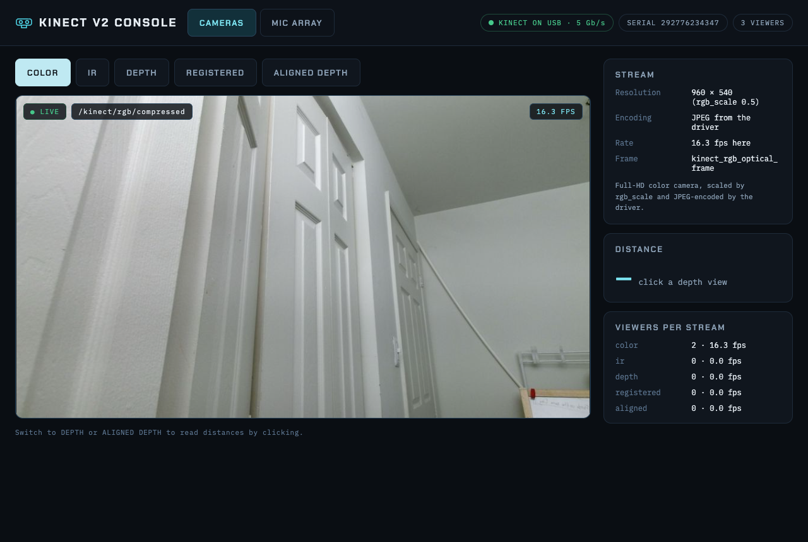
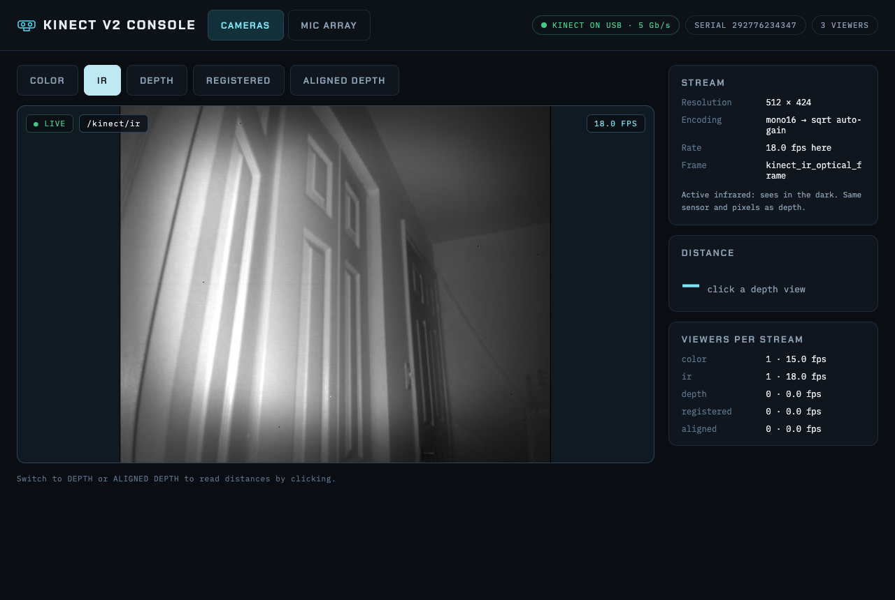
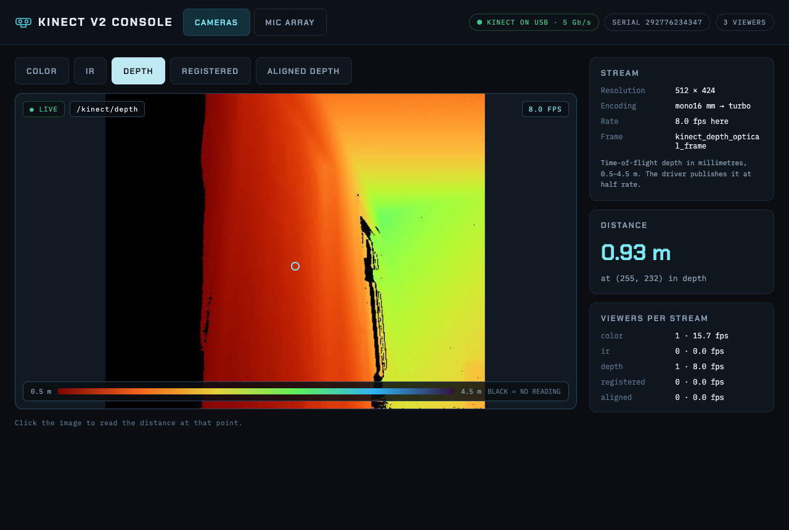
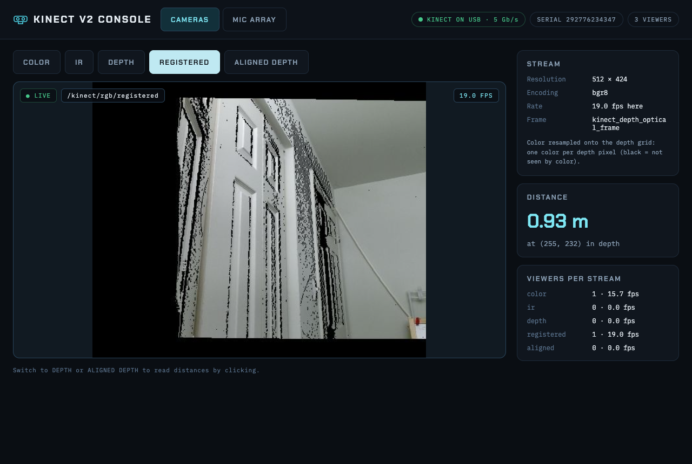
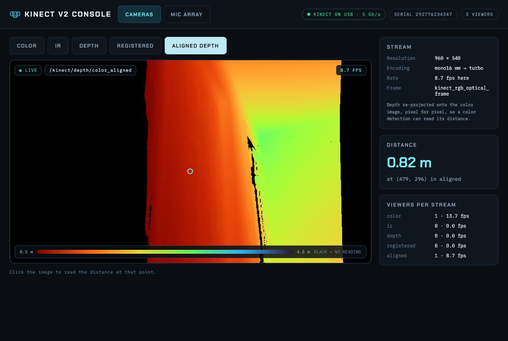
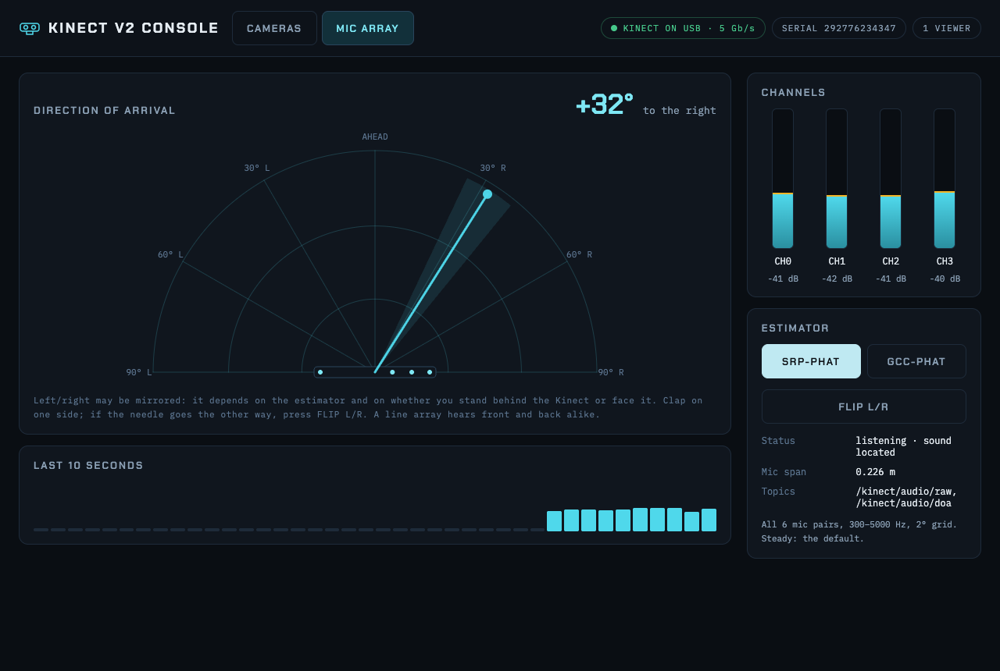

# Kinect v2 on macOS (ROS 2)

A working Kinect v2 stack for Apple Silicon Macs: color, depth, infrared and the
4-microphone array as ROS 2 topics, a web console to look at them, and a USB
hotplug supervisor that starts everything when the sensor is plugged in.

Tested on a Mac mini (M4), macOS 26.3, ROS 2 Kilted via pixi, Kinect v2 with the
Kinect Adapter for Windows (USB id `045e:02c4`, firmware 4.0.3917.0).

```
 PUBLISHERS  (ros2 launch kinect kinect.launch.py)       SUBSCRIBERS  (any number, any time)
 ┌───────────────────────────────┐                       ┌───────────────────────────────┐
 │ kinect_node    (C++)          │──/kinect/rgb/...──┐   │ kinect_console  (web, :8095)  │
 │   libfreenect2: color/depth/IR│──/kinect/depth────┼──▶│ kinect_tools viewers          │
 │ audio_publisher (Python)      │──/kinect/audio/...┤   │ ros2 topic echo / rviz2       │
 │   CoreAudio "Xbox NUI Sensor" │                   │   │ your own nodes                │
 │ pointcloud_node (Python)      │──/kinect/pointcloud   └───────────────────────────────┘
 └───────────────────────────────┘
        ▲ started / stopped by hotplug/kinect_hotplug.py when the Kinect appears on USB
```

Publishers and subscribers are separate processes. Start one set of publishers,
then as many subscribers as you like. Each stream is only produced while
something subscribes to it, so an idle topic costs nothing.

---

## 1. What you need

| | |
|---|---|
| Sensor | Kinect v2 (Kinect for Windows v2, or Xbox One Kinect) |
| Adapter | **Kinect Adapter for Windows**: it supplies the 12 V power the sensor needs and converts its port to USB 3.0 |
| Mac | Apple Silicon (arm64); an Intel Mac works the same way with `/usr/local` Homebrew |
| Port | A **USB 3** port (5 Gb/s or faster). On USB 2 the Kinect enumerates but cannot stream |
| macOS | 14 or newer (tested on 26.3) |
| Disk | About 5 GB for the ROS 2 environment |

---

## 2. Connecting the Kinect to the Mac

1. Plug the adapter's power brick into the wall and the Kinect's cable into the
   adapter. The adapter's light turns on.
2. Plug the adapter's USB cable into a **USB 3** port on the Mac (directly, or
   through a USB 3 hub).
3. Check it (works before anything is installed: it uses only macOS's own
   Python and `ioreg`):
   ```bash
   python3 hotplug/kinect_hotplug.py --scan
   # vid=0x045e speed=3  Xbox NUI Sensor
   # kinect           present=True superspeed_ok=True
   ```
   `speed=3` means 5 Gb/s (SuperSpeed); `4` means 10 Gb/s. `speed=2` (480 Mb/s)
   means a USB 2 link, which cannot stream. Use a USB 3 port, or power-cycle the
   adapter (next point).
4. **The Kinect only re-enumerates when its adapter loses power.** If it stops
   responding, or shows up at USB 2 speed on a USB 3 port, pull the adapter's
   **power** plug for about 10 s (the USB cable can stay in) and plug it back.
   Unplugging only the USB cable often does not help.

`scripts/kinect_debug.sh` prints a fuller USB report if detection fails.

### How macOS sees the Kinect

| Function | macOS path | Used by |
|---|---|---|
| Color, depth, IR | Vendor USB interfaces claimed through **libusb** by libfreenect2. Only **one process** can own them at a time | `kinect_node` |
| Microphones | Standard **USB Audio Class** interface. macOS's own driver exposes it as the CoreAudio input **"Xbox NUI Sensor"** (4 channels, 16 kHz). Any number of apps can read it | `audio_publisher` (PortAudio via `sounddevice`) |
| Presence | The I/O Registry (`ioreg -p IOUSB`). Readable without permissions while the device is in use | `hotplug/`, the console's USB badge |

Two consequences:

* When `kinect_node` opens the device, libfreenect2 **resets the sensor's USB
  link**, and that also resets the audio interface. An audio stream that was open
  dies or goes silent. `audio_publisher` exits after 6 s without audio, and the
  launch file respawns it 2 s later. In the logs that looks like
  `No audio for 6 s — exiting for a clean respawn` followed by
  `Audio stream opened`. That sequence is normal.
* libfreenect2's color decoder (VideoToolbox) uses GLFW, which turns the process
  into a Cocoa app. If that process ever crashed, macOS may show a
  "reopen windows?" dialog the next time it starts. A process started from a
  terminal then waits on that dialog until you click it.

---

## 3. Quick start: one command

1. Connect the Kinect as described in section 2. You can also do this later:
   the install steps don't need the Kinect, only the final start step does.
2. In Terminal:

```bash
git clone https://github.com/SriharshaShesham/KinectV2-Ros2-macOS.git
cd KinectV2-Ros2-macOS
./kinect.sh
```

It checks each step and does only what's missing, so it is safe to run again:

1. Xcode Command Line Tools (opens Apple's installer if they're missing)
2. Homebrew
3. libfreenect2, built from source (a few minutes; asks for your password to install into `/usr/local`)
4. pixi, then the ROS 2 environment pinned by `pixi.lock`
5. Builds the workspace
6. Checks that the Kinect is on USB at SuperSpeed and that nothing else is using it
7. Starts the publishers and the web console, then opens <http://127.0.0.1:8095>

**Ctrl-C** stops everything. The first run on a new Mac takes about 15–20
minutes (libfreenect2 build, ROS 2 download, and a 1–3 minute first driver
start). Later runs start in a few seconds.

| Command | Does |
|---|---|
| `./kinect.sh` | install what's missing, build, run, open the console |
| `./kinect.sh install` | install + build only |
| `./kinect.sh run` | run only (`--lan` to reach the console from other devices, `--port=8096`, `--no-browser`, `--no-console`) |
| `./kinect.sh stop` | stop a stack started from another terminal |
| `./kinect.sh status` | what is installed, plugged in and running |

Logs: `log/kinect.log` (driver and nodes), `log/console.log`. If the script
says the Kinect is missing or not at USB 3 speed, see section 2,
"Connecting the Kinect to the Mac". The rest of this README explains each step, if you'd rather
do them by hand or want to know how it works.

---

## 4. Install, step by step

`./kinect.sh` does all of this for you. These are the same steps by hand. Every command runs in Terminal; steps 1–3 happen once per Mac.

### Step 1: Xcode Command Line Tools and Homebrew

```bash
xcode-select --install                       # compilers, git, macOS SDK (skip if already installed)
/bin/bash -c "$(curl -fsSL https://raw.githubusercontent.com/Homebrew/install/HEAD/install.sh)"
```

### Step 2: libfreenect2, the Kinect v2 driver library

libfreenect2 talks to the sensor over libusb from user space; no kernel extension
is needed. It has no Homebrew or conda package for Apple Silicon, so it is built
from source. The script reproduces the exact build this repo was tested with
(libfreenect2 commit `fd64c5d`, OpenCL depth decoding, VideoToolbox JPEG
decoding, installed to `/usr/local`):

```bash
bash scripts/install_libfreenect2.sh
```

What the script does, if you prefer to type it yourself:

```bash
brew install cmake pkgconf libusb glfw jpeg-turbo
git clone https://github.com/OpenKinect/libfreenect2.git ~/src/libfreenect2
cd ~/src/libfreenect2 && git checkout fd64c5d9b214df6f6a55b4419357e51083f15d93
cmake -S . -B build -DCMAKE_BUILD_TYPE=RelWithDebInfo -DCMAKE_INSTALL_PREFIX=/usr/local \
      -DCMAKE_POLICY_VERSION_MINIMUM=3.5 \
      -DENABLE_OPENCL=ON -DENABLE_OPENGL=ON -DENABLE_CUDA=OFF -DBUILD_OPENNI2_DRIVER=OFF
cmake --build build -j
sudo cmake --install build
```

> `-DCMAKE_POLICY_VERSION_MINIMUM=3.5` is required with CMake 4: libfreenect2
> declares `cmake_minimum_required(2.8)`, which CMake 4 otherwise refuses.

Check it before going further. Plug the Kinect in (see "Connecting the Kinect to the Mac") and run the
bundled viewer:

```bash
~/src/libfreenect2/build/bin/Protonect cl    # a window with color, depth and IR; Esc quits
```

### Step 3: pixi (the ROS 2 environment manager)

```bash
curl -fsSL https://pixi.sh/install.sh | bash
exec $SHELL                                   # reload PATH so `pixi` is found
```

### Step 4: The ROS 2 environment for this repo

```bash
cd KinectV2-Ros2-macOS            # the cloned repo
pixi install -e kilted
```

This installs ROS 2 Kilted (RoboStack), OpenCV, numpy, sounddevice and aiohttp
into `.pixi/`. **Keep `pixi.lock`.** It pins versions known to work together.
A fresh solve with newer packages built a `kinect_node` that aborts at start
(`symbol not found '_PyExc_RuntimeError'`).

### Step 5: Build

```bash
pixi run -e kilted build                      # colcon build of kinect, kinect_tools, kinect_console
```

### Step 6: Give your terminal microphone access

The mic array is an ordinary macOS audio input. The first time
`audio_publisher` runs, macOS asks whether your terminal app (Terminal, iTerm,
VS Code…) may use the microphone. Answer **Allow**. If you missed the prompt:
System Settings → Privacy & Security → Microphone → enable your terminal app.
Without this, macOS delivers silence.

### Step 7: Check that everything works

```bash
pixi run -e kilted scan        # is the Kinect on USB, at SuperSpeed?
pixi run -e kilted test        # unit tests (no hardware needed)
pixi run -e kilted kinect      # start the publishers (leave this running)
```

In a second terminal:

```bash
pixi run -e kilted console     # then open http://127.0.0.1:8095
pixi run -e kilted test-live   # live tests: 3 subscribers, every topic, real rates
```

> **First start is slow.** The first time a freshly installed environment
> starts, macOS checks the code signature of every new library. `kinect_node`
> can sit silently for 1–3 minutes before it logs `Kinect v2 started`. Later
> starts take about 2 s.

---

## 5. Running

### Publishers

```bash
pixi run -e kilted kinect
# or, inside `pixi shell -e kilted`:
ros2 launch kinect kinect.launch.py                       # everything
ros2 launch kinect kinect.launch.py pointcloud:=false     # without the point cloud
ros2 launch kinect kinect.launch.py audio:=false          # video only
```

### Subscribers: start any number, in any terminals

```bash
pixi shell -e kilted                       # one-time per terminal: ROS on PATH, workspace sourced
ros2 run kinect_console console            # web console, http://127.0.0.1:8095
ros2 run kinect_console console --port 8096 --host 0.0.0.0   # a second one, reachable from the LAN
ros2 run kinect_tools rgb_viewer           # OpenCV windows
ros2 run kinect_tools depth_viewer
ros2 run kinect_tools ir_viewer
ros2 run kinect_tools pointcloud_viewer
ros2 run kinect_tools unified_viewer
ros2 run kinect_tools audio_saver --ros-args -p channels:=4 -p output_directory:=$HOME/Desktop
                                           # WAV of /kinect/audio/raw (channels:=4 is required: the default 1 garbles it)
ros2 run kinect_tools diagnose_topics      # shapes, encodings, rates
ros2 topic hz /kinect/rgb/compressed
rviz2                                      # add PointCloud2 on /kinect/pointcloud
```

`ros2 run kinect_tools audio_listener` is not a subscriber. It plots the
microphones by reading CoreAudio directly, which is useful to check the mic
without ROS.

Your own subscriber is an ordinary ROS 2 node:

```python
import numpy as np, rclpy
from sensor_msgs.msg import Image

rclpy.init()
node = rclpy.create_node("my_depth_reader")
def on_depth(msg):
    d = np.frombuffer(bytes(msg.data), "<u2").reshape(msg.height, msg.width)   # millimetres
    print("centre distance: %d mm" % d[msg.height // 2, msg.width // 2])
node.create_subscription(Image, "/kinect/depth", on_depth, 1)
rclpy.spin(node)
```

### The web console

`ros2 run kinect_console console`, then open <http://127.0.0.1:8095>.

* **CAMERAS**: buttons switch between **Color**, **IR**, **Depth**,
  **Registered** (color resampled onto the depth grid) and **Aligned depth**
  (depth re-projected onto the color image). Click a depth view to read the
  distance at that point. The side panel shows resolution, encoding, live
  frame rate, and how many viewers are on each stream.
* **MIC ARRAY**: four channel level meters (dB, with peak hold), a
  direction-of-arrival fan showing where sound comes from, the last 10 seconds
  of directions, a switch between the SRP-PHAT and GCC-PHAT estimators (it
  changes `audio_publisher`'s parameter live), and a **FLIP L/R** button
  (see "Left and right in the mic view" below).

| Color | IR |
|---|---|
|  |  |
| **Depth**, with a click reading the distance | **Registered** (color on the depth grid) |
|  |  |
| **Aligned depth** (depth on the color grid) | **Mic array** |
|  |  |

The camera screenshots are live from the Kinect (the depth view shows a
click reading 0.93 m). The mic array screenshot was taken with a simulated
talker about 30° to one side.

#### Left and right in the mic view

**The mic view's left and right can be the opposite of yours.** The needle shows
the direction the estimator computes, and whether that matches the left/right
you expect depends on two things:

1. **Where you stand.** Behind the Kinect, looking the way it looks, your left
   is the Kinect's left. Facing the Kinect, as a person talking to it does,
   your left is the Kinect's **right**. Same sound, opposite answer.
2. **The estimator.** For the same sound, `srp` (the default) and `gcc` report
   opposite signs (see Known issues), so switching estimators mirrors the
   needle too.

Calibrate once: stand where you normally stand, clap or talk well off to one
side, and watch the needle. If it swings to the other side, press **FLIP L/R**.
The browser remembers the choice (per browser, until you clear site data). If
you switch estimators, check again. Front and back can't be told apart at all:
a line of microphones hears a sound in front and its mirror image behind
identically.

The console is a subscriber like any other. Each stream gets one ROS
subscription however many browsers watch it, and each browser receives the
latest frame, so a slow browser never holds the others back. By default it
listens on `127.0.0.1` only; `--host 0.0.0.0` exposes it to the network
(it has no password).

---

## 6. Topics

| Topic | Type | Content | Rate (measured) |
|---|---|---|---|
| `/kinect/rgb/compressed` | `sensor_msgs/CompressedImage` | Color, JPEG, 960×540 (`rgb_scale` 0.5) | ~16 Hz |
| `/kinect/rgb` | `sensor_msgs/Image` | Color, `bgr8`, same size (only encoded while subscribed) | ~16 Hz |
| `/kinect/depth` | `sensor_msgs/Image` | 512×424 `mono16`, millimetres, 0 = no reading | ~8 Hz (half rate) |
| `/kinect/ir` | `sensor_msgs/Image` | 512×424 `mono16` infrared amplitude | ~17 Hz |
| `/kinect/rgb/registered` | `sensor_msgs/Image` | 512×424 `bgr8`: color sampled at each depth pixel | ~16 Hz |
| `/kinect/depth/color_aligned` | `sensor_msgs/Image` | `mono16` mm, color-sized and pixel-aligned to `/kinect/rgb` | ~8 Hz |
| `/camera/rgb/camera_info` | `sensor_msgs/CameraInfo` | Color intrinsics (scaled to `rgb_scale`) | with frames |
| `/camera/depth/camera_info` | `sensor_msgs/CameraInfo` | Depth/IR intrinsics + distortion (factory calibration) | with frames |
| `/kinect/audio/raw` | `std_msgs/ByteMultiArray` | 4-channel interleaved int16 PCM, 16 kHz, 50 ms chunks | 20 Hz |
| `/kinect/audio/mono` | `std_msgs/ByteMultiArray` | Mono (mean of 4 channels) int16 | 20 Hz |
| `/kinect/audio/doa` | `std_msgs/Float32` | Direction of arrival, degrees (−90…90); only when sound is above the noise floor | when loud |
| `/kinect/pointcloud` | `sensor_msgs/PointCloud2` | XYZRGB, every 4th pixel, 0.5–4.5 m | 5 Hz |

Frames: `kinect_rgb_optical_frame`, `kinect_depth_optical_frame`,
`kinect_ir_optical_frame` (x right, y down, z forward).

The sensor delivers 30 fps. `kinect_node` processes frames in one loop, which
caps the published rate at about 15–18 fps on an M4. The driver logs
`[fps] received … published …` every 5 s.

## 7. Parameters

Pass them with `--ros-args -p name:=value`. To make them persistent, put them in
`~/.kinectv2/params.yaml` (or the file named by `$KINECT_PARAMS`). The launch
file loads it after the defaults:

```yaml
kinect_node:
  ros__parameters:
    rgb_scale: 1.0          # full 1920x1080
audio_publisher:
  ros__parameters:
    doa_method: gcc
```

| Node | Parameter | Default | Meaning |
|---|---|---|---|
| `kinect_node` | `pipeline` | `cl` | Depth decoder: `cl` (OpenCL on the Apple GPU) or `cpu` |
| | `rgb_scale` | `0.5` | Color scale: 0.5 = 960×540, 0.33 = 640×360, 1.0 = 1920×1080. The main CPU dial |
| | `target_fps` | `30` | Publish rate cap |
| | `jpeg_quality` | `80` | JPEG quality of `/kinect/rgb/compressed` |
| | `publish_ir` | `true` | Publish `/kinect/ir` |
| | `serial` | `""` | Pick a device when several are attached |
| `audio_publisher` | `device_name` | `Xbox NUI Sensor` | CoreAudio device to capture |
| | `sample_rate`, `channels`, `chunk_ms` | 16000, 4, 50 | Capture format |
| | `doa_method` | `srp` | `srp` = SRP-PHAT over all 6 mic pairs (steady); `gcc` = GCC-PHAT on the outer pair |
| | `doa_gate` | `2.0` | Publish a direction only when louder than this × the noise floor |
| | `mic_spacing_m` | `0.226` | Outer mic pair spacing (gcc) |
| `pointcloud_node` | `downsample`, `min_depth_m`, `max_depth_m`, `use_color`, `target_hz` | 4, 0.5, 4.5, true, 5 | Point cloud density, range, colouring and rate |

`kinect_node` reads its parameters once at start, so changing them needs a
restart. `audio_publisher` reads `doa_method` and `doa_gate` live.

---

## 8. Auto-start when the Kinect is plugged in

`hotplug/kinect_hotplug.py` polls the USB bus every 2 s (`ioreg`, about 30 ms per
poll):

* Kinect appears at SuperSpeed → it starts the publishers, then (after 8 s) the
  web console.
* Kinect disappears → it stops them, dependents first. Each runs in its own
  process group, stopped with SIGINT → SIGTERM → SIGKILL, so nothing is
  orphaned.
* Kinect present but stuck at USB 2 for 5 polls, or crashing 3 times in 5
  minutes → it stops retrying and posts a macOS notification asking for a
  power cycle of the adapter. The state clears once the Kinect drops off the
  bus and comes back.

Try it in the foreground first:

```bash
python3 hotplug/kinect_hotplug.py --scan     # one detection pass
python3 hotplug/kinect_hotplug.py            # supervise; Ctrl-C stops it and everything it started
```

Install it as a login item (a per-user LaunchAgent):

```bash
bash hotplug/install.sh install      # starts now and at every login
bash hotplug/install.sh status       # what it sees and runs
bash hotplug/install.sh pause        # stop the managed processes, e.g. to run things by hand
bash hotplug/install.sh resume
bash hotplug/install.sh uninstall
```

* Logs: `~/.kinectv2/log/hotplug.log` (decisions), `~/.kinectv2/log/kinect.<name>.log`
  (each component's output). Status: `~/.kinectv2/run/hotplug-status.json`.
* **Full Disk Access.** If this repo lives under `~/Documents`, `~/Desktop` or
  `~/Downloads`, macOS blocks launchd jobs from reading it until the Python the
  agent runs has Full Disk Access. The status file then shows
  `needs-full-disk-access`. Grant it in System Settings → Privacy & Security →
  Full Disk Access (add `/opt/homebrew/bin/python3`), then run
  `bash hotplug/install.sh install` again. Or keep the repo outside those folders.
* While the supervisor runs, don't start `ros2 launch kinect …` by hand. It
  detects the duplicate, refuses to start its own copy and reports `conflict`.
  Use `pause` first.
* Add your own always-on subscribers to `COMPONENTS` in
  `hotplug/kinect_hotplug.py` with `requires=["kinect"]`.

---

## 9. Tests

```bash
pixi run -e kilted test        # 37 unit tests, no hardware needed
pixi run -e kilted test-live   # with the publishers running: 11 live tests
```

| File | Covers |
|---|---|
| `tests/test_audio_doa.py` | `audio_publisher` direction finding (SRP-PHAT and GCC-PHAT) on a simulated sound source hitting the Kinect's mic layout, with and without noise |
| `tests/test_convert.py` | Depth / IR / color conversions, depth readout, audio levels |
| `tests/test_console_server.py` | Web console with a fake ROS side: one subscription fanned out to 5 browsers, release when the last leaves, snapshots, WebSocket audio, estimator switch |
| `tests/test_usb_detect.py` | Kinect detection from `ioreg` output (SuperSpeed, USB 2, absent, other Microsoft devices) |
| `tests/test_hotplug.py` | What the supervisor runs for each USB state, dependency order, process-group start/stop, crash backoff |
| `tests/live/test_live_topics.py` | **Real Kinect**: 3 independent subscriber nodes each receive every topic at the expected rate; depth in mm with valid pixels; factory calibration; 4-channel audio |

---

## 10. Troubleshooting

| Symptom | Cause / fix |
|---|---|
| `scan` shows nothing | Adapter not powered, or not a USB 3 port. Run `scripts/kinect_debug.sh` |
| `speed=2` on a USB 3 port | Power-cycle the adapter (power plug, not USB), ~10 s |
| `Failed to open device` (or `No Kinect v2 device found`) in the driver log, but `scan` sees it | Another process has the device, e.g. another `kinect_node`, `Protonect`, or the hotplug supervisor: `pgrep -fl "kinect_node\|Protonect"`. Only one process can stream |
| `kinect_node` silent for minutes after a fresh install | First-load signature checks of new libraries (see "Check that everything works" under Install). Wait |
| `symbol not found '_PyExc_RuntimeError'` | Package versions drifted from `pixi.lock`. Restore it (`git checkout pixi.lock`), `rm -rf .pixi build install`, then reinstall and rebuild |
| `Package 'freenect2' not found` during build | libfreenect2 is not installed, or `/usr/local/lib/pkgconfig` is missing from `PKG_CONFIG_PATH` (the pixi env sets it) |
| Audio levels zero / `Audio device 'Xbox NUI Sensor' not found` | Microphone permission for your terminal (Step 6), or the Kinect is not on USB |
| `No audio for 6 s — exiting for a clean respawn` once at start | Normal: the driver's USB reset restarted the audio interface (see "How macOS sees the Kinect") |
| Console shows `WAITING FOR DRIVER` | Publishers not running: `pixi run -e kilted kinect` |
| A process hangs at start after a crash | macOS "reopen windows?" dialog (see "How macOS sees the Kinect"). Click it, or log out and back in |

## 11. Known issues

* **DOA sign differs between the two estimators.** For the same sound,
  `doa_method: srp` reports the opposite sign to `gcc` (shown with a
  simulated source in `tests/test_audio_doa.py::test_sign_conventions_as_shipped`).
  `srp` is negative toward the channel-3 end of the bar, `gcc` positive. Check
  the physical direction once by clapping to one side, and flip the sign in
  your own subscriber if needed. The console has a FLIP L/R button for this
  (see "Left and right in the mic view").
* `kinect_node` holds its libfreenect2 pipeline in a `std::unique_ptr` while
  `Freenect2::openDevice()` also takes ownership of it. It is harmless in
  practice (the device object is never deleted), but don't add a
  `delete dev_` without first changing that `unique_ptr` to a `release()`.
* The published frame rate is about half the sensor's 30 fps (single-threaded
  publish loop; see "Topics").

---

## Repository layout

```
kinect.sh              one command: install what's missing, build, run (./kinect.sh --help)
src/kinect/            C++ driver node (libfreenect2) + kinect.launch.py   — publisher
src/kinect_tools/      audio_publisher, pointcloud_node                   — publishers
                       rgb/depth/ir/pointcloud/unified viewers, audio_listener/saver,
                       diagnose_topics, integration_test                  — subscribers
src/kinect_console/    web console (aiohttp + rclpy) with the camera switcher and mic array — subscriber
hotplug/               USB hotplug supervisor + LaunchAgent installer
scripts/               install_libfreenect2.sh, kinect_debug.sh
tests/                 unit tests; tests/live for the real device
pixi.toml, pixi.lock   the ROS 2 Kilted environment (keep the lock)
```
